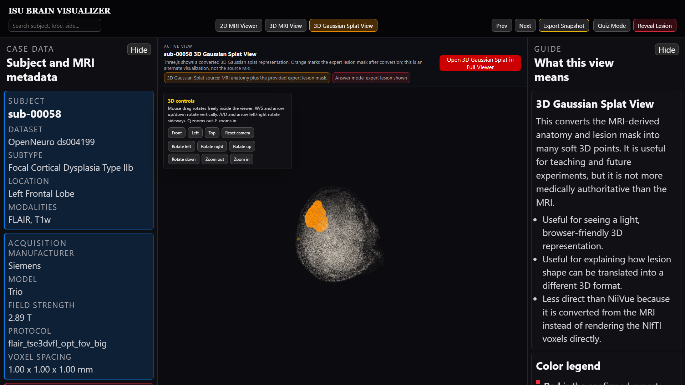

# ISU Cortex · Brain Visualizer

An educational viewer that shows the same expert-labeled brain MRI case in
**2D MRI, 3D MRI, and an interactive 3D Gaussian splat**.



The red MRI overlay and orange splat come from the dataset's **expert lesion
mask**. This viewer displays known labels; it does not discover or diagnose a
lesion. The Python research experiments remain in the repository, but they do
not supply the teaching viewer's lesion answer.

## Start with two ready-made cases

Install **Python 3.11 or newer** and download this repository with GitHub's green
**Code → Download ZIP** button. Extract the ZIP, open a terminal in the extracted
folder, and run:

**Windows (PowerShell):**

```powershell
py -3 scripts/run_viewer.py --download-demo
```

**Mac or Linux (Terminal):**

```bash
python3 scripts/run_viewer.py --download-demo
```

The command downloads and checks a **two-case demo (about 57 MiB)**, then opens
the viewer. No Python packages, Node.js, CUDA, or NVIDIA GPU are needed for
viewing. A current WebGL-capable browser and internet access are required;
NiiVue and Three.js load from pinned public CDN URLs.

Keep the terminal open while viewing. Press **Ctrl+C** there to stop.

[Full step-by-step instructions, with troubleshooting](docs/running-the-project.md)

## View all 85 FCD cases

Use the same command with `--download-all`:

```powershell
py -3 scripts/run_viewer.py --download-all
```

On Mac/Linux, replace `py -3` with `python3`. The command downloads nine
independent packs, checks their SHA-256 fingerprints, combines the case list,
and opens the viewer. It skips packs already installed, so a stopped download
can be restarted. Allow **6 GiB of free space** for downloading and unpacking.

The two-case demo can be expanded to the full set without deleting it.
All 85 viewer cases are hosted separately from the small code repository:

- [Release downloads: demo, all case packs, and checksums](https://github.com/AlexiosBluffMara/isu-brain-visualizer/releases/tag/v0.2.0)
- [Case catalog: all 85 subjects and their pack names](data/cases.csv)
- [Data source, manual downloads, and regeneration](docs/data-and-regeneration.md)

## Use the viewer

1. Choose a case in the left panel. Scroll that panel to reach more metadata and cases.
2. Choose **2D MRI Viewer**, **3D MRI View**, or **3D Gaussian Splat View**.
3. Choose **Quiz Mode** to hide the expert lesion, or **Reveal Lesion** to show it.
4. Rotate the 3D brain and use the camera controls to inspect it.
5. Read the explanation and color key in the right panel. Both side panels use
   twice the earlier text size for clearer large screenshots.
6. Use either panel's **Hide** button to give the brain more room.

The 2D view uses FLAIR when available. The 3D MRI view prefers T1w anatomy.
The expert FLAIR-space mask is placed using its MRI coordinates.
The splat is an MRI-derived teaching representation, rather than a trained
photographic radiance-field reconstruction.

## Data and attribution

Source: [OpenNeuro ds004199, version 1.0.6](https://openneuro.org/datasets/ds004199/versions/1.0.6).
The dataset's published description lists **CC0**.

Schuch F et al. “An open presurgery MRI dataset of people with epilepsy and
focal cortical dysplasia type II.” *Scientific Data* 10, 475 (2023).
[Paper](https://doi.org/10.1038/s41597-023-02386-7) ·
[Dataset DOI](https://doi.org/10.18112/openneuro.ds004199.v1.0.6)

The source cohort contains 85 FCD participants and 85 healthy controls. The
ready-made viewer packages cover the **85 FCD cases**. Instructions for obtaining
the entire source cohort, including controls, are in the data guide.

## Develop and test

Viewing the prepared data does not need this setup. Developers can create a
virtual environment, activate it, and install the Python package:

```bash
python -m venv .venv
# Windows PowerShell: .venv\Scripts\Activate.ps1
# Mac/Linux: source .venv/bin/activate
python -m pip install -e ".[dev]"
python -m pytest -q
```

JavaScript tests use Node.js 22 or newer and have no npm dependencies:

```bash
node --test tests/*.test.mjs
```

After activating the Python environment, `npm test` runs both suites.
`npm run verify:viewer-data` separately checks installed viewer data.
The CI workflow checks source tests on Windows, Mac, and Linux; optional
GPU research tests require their separate dependencies.

## Project map

| Folder or file | Purpose |
| --- | --- |
| `viewer/app.html`, `app.css`, `app.js` | Main viewer and two side panels |
| `viewer/index.html` | NiiVue 2D and 3D MRI views |
| `viewer/splat.html` | Three.js Gaussian splat view |
| `scripts/run_viewer.py` | Checked downloads and local launcher |
| `data/release-assets.json` | Release filenames, case lists, sizes, and checksums |
| `scripts/package_release_data.py` | Rebuild public data packages |
| `src/fcd_prototype/` | MRI-processing and experimental research pipeline |
| `tests/` | Source, viewer, and release-installer tests |

See [third-party notices](THIRD_PARTY_NOTICES.md) for dependency and data terms.
Public availability does not assign a new license to the project's own code.
