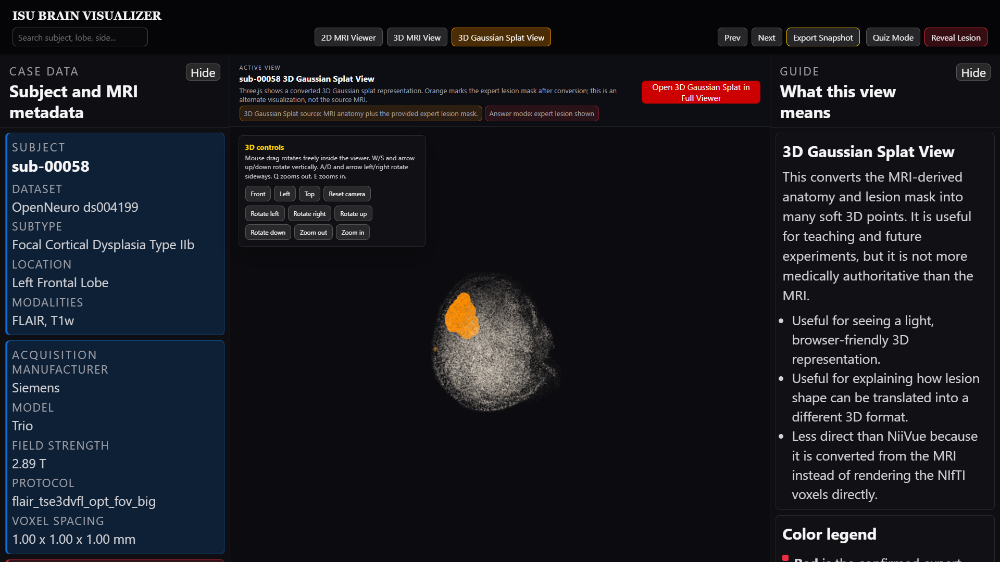

# Run ISU Cortex on another computer

This guide starts from an ordinary Windows, Mac, or Linux computer.
You are downloading two things: the **viewer code** and the **brain pictures it
opens**. The launcher puts those pictures in the right place for you.

## 1. Install Python

Install Python **3.11 or newer** from [python.org](https://www.python.org/downloads/).
On Windows, enable the Python launcher during installation. On Mac/Linux,
make sure the `python3` command is available.

Check it in PowerShell (Windows):

```powershell
py -3 --version
```

Or Terminal (Mac/Linux):

```bash
python3 --version
```

The number must be 3.11 or higher. Python runs the small local web server.
The prepared viewer needs no pip packages and no special NVIDIA graphics card.

## 2. Download and extract the code

1. Open [the repository](https://github.com/AlexiosBluffMara/isu-brain-visualizer).
2. Click the green **Code** button.
3. Click **Download ZIP**.
4. Extract the ZIP into a normal folder, such as Documents.
5. Open a terminal **inside that extracted folder**. You should see
   `README.md`, `viewer`, and `scripts` in it.

If Git is installed, cloning is an alternative:

```bash
git clone https://github.com/AlexiosBluffMara/isu-brain-visualizer.git
cd isu-brain-visualizer
```

## 3. Download the two-case review package and start

Windows:

```powershell
py -3 scripts/run_viewer.py --download-demo
```

Mac/Linux:

```bash
python3 scripts/run_viewer.py --download-demo
```

The launcher does four jobs:

1. Downloads the approximately 57 MiB review package.
2. Checks its SHA-256 fingerprint. This catches a damaged or wrong download.
3. Places the two cases under `outputs/end_to_end_fcd85_hd`.
4. Opens your browser at a local address such as
   [the viewer](http://127.0.0.1:8081/viewer/app.html?subject=sub-00058&mode=mri2d&lesion=shown).

A successful start prints `Data ready: 2 case(s).` Keep that terminal open.

The demo contains **sub-00058** and **sub-00100**. Both have MRI volumes,
an expert lesion mask, a browser splat, and case metadata.

## 4. Learn the controls



- **Left panel:** the selected case, scanner information, lesion measurements,
  and case browsing controls. Scroll inside it to see the rest.
- **Middle:** the actual brain viewer.
- **Right panel:** a simple explanation, color key, and definitions.
- **2D MRI Viewer:** inspect MRI slices from three directions.
- **3D MRI View:** rotate the MRI volume.
- **3D Gaussian Splat View:** rotate the alternate 3D teaching model.
- **Quiz Mode:** hide the expert answer.
- **Reveal Lesion:** show the expert answer again.
- **Hide:** collapse a side panel when you want more brain space.

Red in MRI and orange in splats represent the expert-provided lesion.
Dark areas can be background or low signal; they are not automatically lesions.

## 5. Expand to every FCD viewer case

Windows:

```powershell
py -3 scripts/run_viewer.py --download-all
```

Mac/Linux:

```bash
python3 scripts/run_viewer.py --download-all
```

This installs all **85 FCD cases** in nine smaller packs. The unpacked viewer
assets total about 2.5 GiB. Keep at least 6 GiB free while installing.
The installer safely combines packs and skips completed ones on the next run.
It does not overwrite different data you have placed in a case folder.

The full source cohort also includes 85 healthy controls; those controls are
available from OpenNeuro, as explained in [the data guide](data-and-regeneration.md).

## 6. Start again later

You only need the shorter command once data is installed:

```powershell
py -3 scripts/run_viewer.py
```

Use `python3` instead of `py -3` on Mac/Linux.

To check the local data without opening a browser:

```powershell
py -3 scripts/run_viewer.py --check
```

To stop, press **Ctrl+C** in the server terminal. Closing the browser alone
does not stop the server.

## 7. Manual downloads or a machine without download access

1. Open the [v0.2.0 release](https://github.com/AlexiosBluffMara/isu-brain-visualizer/releases/tag/v0.2.0).
2. Download `isu-brain-demo-v0.2.0.zip`, or any full-case pack.
3. Keep the original filename.
4. From the code folder, install the downloaded archive with:

```powershell
py -3 scripts/run_viewer.py --demo-archive "C:\Downloads\isu-brain-demo-v0.2.0.zip"
```

On Mac/Linux, use `python3` and the file's actual path.
Despite its name, `--demo-archive` accepts any named pack in this release.
Repeat with other packs to add their cases. The launcher checks each ZIP
before installing it. Do not manually mix `index.json` files from different packs.

Browser libraries still need internet access from jsDelivr on page load.
The release is not a fully offline distribution.

## Troubleshooting

**The Python command is missing:** install Python, close the terminal, and open
a new one. On Windows, try `python` if your installation does not provide `py`.

**The terminal cannot find scripts/run_viewer.py:** open the terminal in the
extracted code folder, not the ZIP file or the `viewer` subfolder.

**Port 8081 is already in use:** add `--port 8082` to the launcher command.
Open the address it prints.

**The browser stays blank:** use a current Chrome, Edge, Firefox, or Safari
with WebGL enabled. Confirm jsDelivr is reachable, and refresh. Some older
machines render the 3D views slowly.

**A download stops:** rerun the same command. Completed packs are skipped;
the unfinished pack is downloaded again.

**The checksum fails:** download that release asset again. Do not bypass the check.

**Existing data differs:** the installer found another version of a case.
Keep a backup and move your existing `outputs` folder aside before installing
a separate release. Your files are preserved.

**Large text needs more space:** scroll inside the panels, make the browser
window wider, or collapse a panel. On narrow screens the panels stack above
and below the brain.

## Developer checks

Activate your virtual environment and install `.[dev]`, as described in the
README. Then run:

```bash
python -m pytest -q
node --test tests/*.test.mjs
python scripts/verify_viewer_dataset.py
```

The last command checks the data you have installed. It should report zero
bad subjects. It will show 2 subjects after the demo or 85 after all packs.
